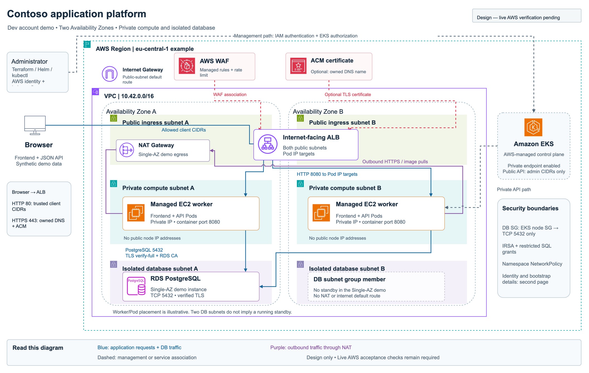

# Contoso AWS platform demonstration

A small Terraform deployment for an AWS DevOps interview: a web frontend/API on private EKS workers, backed by RDS PostgreSQL in separate isolated subnets. An internet-facing ALB exposes the application. IAM, TLS, security groups and NetworkPolicy protect distinct parts of the request path.

[](https://github.com/westfood/aws-eks-assignment/actions/workflows/ci.yml)

**Deployment status:** prepared without an AWS account. The container image and Compose database roundtrip passed in GitHub Actions. An AWS plan/apply, ECR push, ingress, RDS IAM/TLS checks and teardown must still be performed and recorded. CI does not establish live AWS behavior.

Verification on **3 November 2026**: [all six CI jobs passed](https://github.com/westfood/aws-eks-assignment/actions/runs/41670032344) at commit `f376333`. They checked all seven mise-pinned tools on Linux, validated all three Terraform roots, ran 28 mocked Terraform checks, 34 helper/account-targeting tests and 23 application tests against PostgreSQL 17, built the actual image, exercised Compose write/read, and checked UID `10001` and a read-only root filesystem. The environment guards were tested without AWS credentials. An isolated native PostgreSQL 18.6 instance and a real browser also exercised local desktop/mobile behavior. Live account permissions, RDS IAM/TLS and AWS networking remain unverified.



- [Architecture and network boundaries](docs/architecture.md), [decisions](docs/decisions.md), [editable draw.io diagram](docs/architecture.drawio)
- [Environment targeting](docs/environments.md), [interview walkthrough](docs/interview-walkthrough.md), [cost and cleanup](docs/cost-and-cleanup.md), [primary sources](docs/sources.md)
- Presentation: see `presentation/` for the English stakeholder deck and speaker notes.
- Application: see `app/` for the frontend, database code, tests and image.

The same source supports **dev, test and prod in separate AWS accounts**. The live presentation uses **dev only**. Dev uses two worker nodes, one NAT Gateway and a Single-AZ database; test/prod examples enable AZ-local NAT and Multi-AZ RDS. Two database subnets alone do not imply a Multi-AZ DB. This application accepts synthetic messages without end-user authentication, so account targeting and HA settings do not make it a production-ready product. The repository does not provision AWS accounts, Control Tower or an organization-wide landing zone.

## 1. Prepare tools

Install [mise](https://mise.jdx.dev/getting-started.html), Git, and a working Docker engine with Compose and Buildx. [mise.toml](mise.toml) pins the project tools; [mise.lock](mise.lock) records platform-specific downloads for macOS ARM64 and Linux x86-64. CI uses the same configuration.

Run commands from the repository root in Bash/Zsh:

```bash
git clone https://github.com/westfood/aws-eks-assignment.git
cd aws-eks-assignment
cat mise.toml
mise trust
mise install --locked
eval "$(mise env -s zsh)" # Use -s bash in Bash
umask 077
mise run tools:check
mise run tools:docker
```

The environment command affects this terminal session. You can instead prefix individual commands with `mise exec --`. Persistent [shell activation](https://mise.jdx.dev/shell-setup.html) is optional. Project settings give pinned tools precedence over earlier Homebrew/system binaries. Docker's engine, draw.io Desktop and the optional presentation authoring runtime remain separate prerequisites.

## 2. Configure the dev account target

Every cloud command requires `--env dev`, `--env test` or `--env prod`. The helper selects that target's AWS profile, verifies its account, and uses its private state, plans, outputs and kubeconfig. There is no implicit default environment. The interview's `demo` command accepts dev only.

Prepare **dev** for the presentation:

```bash
cp environments/dev.example.json environments/dev.json
```

Edit `environments/dev.json`: provide the real dev account ID, its AWS profile, a globally unique dev state-bucket name, the intended IAM administrator role/user ARN, and your trusted public IPv4 `/32` under `infra.admin_cidrs`. The JSON file is ignored by Git. Use separate account IDs, profiles and buckets when you later prepare `test.json` or `prod.json` from their examples. See [environment configuration and isolation](docs/environments.md).

Authenticate the configured profile using temporary credentials. For a standalone dev account with a console IAM user or federated role, AWS CLI browser login can supply a separate process-credential profile:

```bash
aws login --profile contoso-dev-signin
aws configure set credential_process 'aws configure export-credentials --profile contoso-dev-signin --format process' --profile contoso-dev
aws configure set region eu-central-1 --profile contoso-dev
aws --profile contoso-dev sts get-caller-identity
```

The login identity needs `SignInLocalDevelopmentAccess` and deployment permissions. This exercise creates IAM roles, policies, EKS access entries and networking, so ordinary `PowerUserAccess` is insufficient for IAM creation. Use a non-root deployment identity; production needs a reviewed deployment role. Renew this session with `aws login --profile contoso-dev-signin`. [AWS browser login](https://docs.aws.amazon.com/cli/latest/userguide/cli-configure-sign-in.html)

If you already use IAM Identity Center, configure the target profile with `aws configure sso --profile contoso-dev` and renew it with `aws sso login --profile contoso-dev` instead. Account assignments require an organization instance. Creating an organization can change a new account's plan and credits; review the [Identity Center setup consequences](https://docs.aws.amazon.com/singlesignon/latest/userguide/enable-identity-center.html) first. The repository creates neither an account nor an organization. Secure any newly created account's root login with MFA and review [cost and cleanup](docs/cost-and-cleanup.md) before deployment.

For `infra.admin_principal_arn`, use the full IAM user/role ARN, including a role's path. An STS assumed-role session ARN is not valid. These explicit-profile commands identify the underlying IAM principal:

```bash
CALLER_ARN="$(aws --profile contoso-dev sts get-caller-identity --query Arn --output text)"
ADMIN_PRINCIPAL_ARN=""
case "$CALLER_ARN" in
  arn:aws:iam::*:user/*)
    ADMIN_PRINCIPAL_ARN="$CALLER_ARN"
    ;;
  arn:aws:sts::*:assumed-role/*)
    ROLE_NAME="${CALLER_ARN#*:assumed-role/}"
    ROLE_NAME="${ROLE_NAME%/*}"
    ADMIN_PRINCIPAL_ARN="$(aws --profile contoso-dev iam get-role --role-name "$ROLE_NAME" --query Role.Arn --output text)"
    ;;
  *)
    printf '%s\n' 'Select a non-root IAM deployment user or role before continuing.' >&2
    ;;
esac
printf '%s\n' "$ADMIN_PRINCIPAL_ARN"
curl --proto '=https' --tlsv1.2 --fail --silent --show-error https://checkip.amazonaws.com
```

Copy the appropriate values into the private config. The IP-check endpoint reports the workstation's public address; a VPN/network change may require a new `/32`.

Review the target without changing AWS, then check its authenticated account:

```bash
mise run target -- --env dev show
mise run target -- --env dev check
```

## 3. Create dev Terraform state storage

The `bootstrap` root creates an encrypted, versioned, private S3 bucket with TLS-only access in the selected account. Its local state stays under the dev artifact directory. Infra and platform use separate S3 state keys in that account. The helper generates the environment-specific input/backend files and isolates Terraform initialization data.

```bash
mise run target -- --env dev terraform bootstrap init
mise run target -- --env dev terraform bootstrap plan
mise run target -- --env dev terraform bootstrap apply
mise run target -- --env dev terraform bootstrap output
```

Review the printed plan before `apply`. Apply uses the saved plan for this exact target and rejects a mismatched plan manifest. Plans, state and generated inputs remain private under `.local/dev/`; real environment JSON files are also ignored. No plan or state is shared with test/prod.

## 4. Plan and deploy dev infrastructure

Before the live apply, check available EKS versions, choose an exact supported PostgreSQL minor and review account quotas:

```bash
mise run target -- --env dev aws eks describe-cluster-versions --query 'clusterVersions[].{version:clusterVersion,status:versionStatus}' --output table
mise run target -- --env dev aws rds describe-db-engine-versions --engine postgres --query 'DBEngineVersions[?starts_with(EngineVersion, `17.`)].EngineVersion' --output table
```

Set `infra.postgres_engine_version` to the chosen minor in `environments/dev.json`. The dev DB defaults to `db.t4g.small` because IAM DB authentication needs memory headroom.

For trusted HTTPS, also set `infra.tls_domain_name` to an owned subdomain and `infra.tls_zone_id` to its public Route53 hosted zone ID. Domain delegation must already work. Terraform requests a regional ACM certificate and creates DNS validation; platform deployment creates the application CNAME. Without those inputs, the dev endpoint is HTTP restricted to trusted client CIDRs and synthetic data.

```bash
mise run target -- --env dev terraform infra init
mise run target -- --env dev terraform infra plan
mise run target -- --env dev terraform infra apply
mise run target -- --env dev terraform infra output
```

The output command writes `.local/dev/infra-outputs.json`. Keep the API CIDRs restricted even if application ingress is later made public. Setting `infra.private_only_api=true` requires a VPC-connected workstation or runner for subsequent Kubernetes/Helm operations; it does not create that connection.

## 5. Build and push the dev application image

ECR is account-specific. Read the repository from dev's managed outputs and build `linux/amd64` for the x86-64 managed nodes, including from an Apple Silicon Mac:

```bash
ECR_REPOSITORY="$(python3 -c 'import json; print(json.load(open(".local/dev/infra-outputs.json"))["ecr_repository_url"]["value"])')"
ECR_REGISTRY="${ECR_REPOSITORY%%/*}"
ECR_NAME="${ECR_REPOSITORY#*/}"
IMAGE_TAG="demo-$(date -u +%Y%m%d%H%M%S)"
mise run target -- --env dev aws ecr get-login-password | docker login --username AWS --password-stdin "$ECR_REGISTRY"
docker buildx build --platform linux/amd64 --tag "$ECR_REPOSITORY:$IMAGE_TAG" --push ./app
IMAGE_DIGEST="$(mise run target -- --env dev aws ecr describe-images --repository-name "$ECR_NAME" --image-ids imageTag="$IMAGE_TAG" --query 'imageDetails[0].imageDigest' --output text)"
APP_IMAGE="$ECR_REPOSITORY@$IMAGE_DIGEST"
printf '%s\n' "$APP_IMAGE"
```

Review ECR scan findings. Platform inputs require `repository@sha256:...`, so changing a tag cannot silently replace the deployed image.

## 6. Deploy the dev Kubernetes platform

The environment helper reads **dev's** infrastructure outputs, checks their account/environment metadata and creates private platform inputs. It refuses to overwrite those inputs unless `--overwrite` is explicit:

```bash
mise run target -- --env dev platform-inputs --image "$APP_IMAGE"
mise run target -- --env dev terraform platform init
mise run target -- --env dev terraform platform plan
mise run target -- --env dev terraform platform apply
mise run target -- --env dev terraform platform output
```

This installs AWS Load Balancer Controller, NetworkPolicies, a DB initialization Job, the frontend/API Deployment, Service and Ingress. The initialization role alone reads the RDS-managed master secret. The serving role permits `rds-db:connect` as the restricted SQL user. Connections use the RDS endpoint and bundled AWS CA with `verify-full`.

With a validated HTTPS hostname, explicitly widen application access while keeping the EKS API restricted:

```bash
mise run target -- --env dev platform-inputs --image "$APP_IMAGE" --ingress-cidr 0.0.0.0/0 --overwrite
mise run target -- --env dev terraform platform plan
mise run target -- --env dev terraform platform apply
```

Both input generation and Terraform reject internet-wide plaintext ingress. Editing inputs requires a new plan; do not reuse a saved plan after changing them.

## 7. Verify and present dev

The generated kubeconfig is `.local/dev/kubeconfig`. It retains EKS CA verification and does not change normal lab contexts. The wrapper selects this file and target context for every Kubernetes command:

```bash
mise run target -- --env dev kubeconfig
mise run target -- --env dev kubectl get nodes
mise run target -- --env dev kubectl -n contoso get pods,jobs,services,ingresses,networkpolicies
mise run target -- --env dev kubectl -n contoso rollout status deployment/contoso-app --timeout=5m
APPLICATION_URL="$(python3 -c 'import json; print(json.load(open(".local/dev/platform-outputs.json"))["application_url"]["value"])')"
printf '%s\n' "$APPLICATION_URL"
mise run target -- --env dev demo
```

`demo` performs read-only readiness checks and is deliberately restricted to dev. Open `$APPLICATION_URL`, save a synthetic message and refresh to show persistence. For an explicit automated write/read check:

```bash
python3 scripts/verify-live.py --url "$APPLICATION_URL" --write-message
```

Inspect AWS boundaries through the same target:

```bash
CLUSTER_NAME="$(python3 -c 'import json; print(json.load(open(".local/dev/infra-outputs.json"))["cluster_name"]["value"])')"
mise run target -- --env dev aws rds describe-db-instances --db-instance-identifier "$CLUSTER_NAME" --query 'DBInstances[0].{public:PubliclyAccessible,multiAZ:MultiAZ,iamAuth:IAMDatabaseAuthenticationEnabled,encrypted:StorageEncrypted,subnets:DBSubnetGroup.Subnets[].SubnetIdentifier,groups:VpcSecurityGroups[].VpcSecurityGroupId}'
mise run target -- --env dev kubectl -n contoso get serviceaccount contoso-app contoso-bootstrap -o yaml
mise run target -- --env dev kubectl -n contoso describe ingress contoso-app
```

Also confirm target-group health, WAF association/rules, NetworkPolicy enforcement and the app role's inability to read the master secret. A successful policy inspection is not a negative live permission test. Record the actual checks, deployed revision and intentionally retained resource categories. See the [interview walkthrough](docs/interview-walkthrough.md).

## Local checks without AWS

```bash
mise run check
```

This checks tool versions, app/helper tests, workflow syntax and all three Terraform roots using mocked providers. It downloads dependencies when needed and performs no AWS deployment. App DB integration is skipped unless the explicit local database settings in [app/README.md](app/README.md) are supplied.

| Task | Purpose |
| --- | --- |
| `mise run tools:check` | Verify pinned CLI versions |
| `mise run tools:docker` | Check Docker engine and plugins |
| `mise run app:setup` | Create `app/.venv` and install locked packages |
| `mise run app:test` | Run app tests; DB integration needs explicit local settings |
| `mise run helpers:test` | Test deployment helpers without AWS |
| `mise run tf:check` | Validate/mock-test all Terraform roots |
| `mise run diagrams:export` | Export draw.io previews with draw.io Desktop |
| `mise run target -- --env dev show` | Inspect a configured account target without cloud operations |

For a separate local Compose test:

```bash
docker compose up --build --detach
python3 scripts/verify-live.py --url http://127.0.0.1:18080 --write-message
docker compose down
```

Compose uses disposable local passwords and disables DB TLS only in its local setup. It does not emulate RDS IAM, AWS networking, ALB or WAF. `docker compose down` retains the synthetic DB volume; `--volumes` deliberately deletes it.

## Tear down the selected environment

The presentation cleanup targets **dev**. Keep the controller running until its Ingress finalizer has removed the ALB. First capture the ALB ARN, then review/apply an Ingress-only destroy plan and wait for AWS deletion:

```bash
ALB_HOSTNAME="$(python3 -c 'import json; print(json.load(open(".local/dev/platform-outputs.json"))["alb_hostname"]["value"])')"
ALB_ARN="$(mise run target -- --env dev aws elbv2 describe-load-balancers --query "LoadBalancers[?DNSName=='$ALB_HOSTNAME'].LoadBalancerArn | [0]" --output text)"
mise run target -- --env dev terraform platform plan --destroy --ingress-only
mise run target -- --env dev terraform platform apply --destroy --ingress-only
mise run target -- --env dev aws elbv2 wait load-balancers-deleted --load-balancer-arns "$ALB_ARN"
mise run target -- --env dev terraform platform plan --destroy
mise run target -- --env dev terraform platform apply --destroy
```

If deletion stalls, inspect the controller and its IAM permissions before removing it. Do not force-remove a finalizer just to complete cleanup.

RDS deletion protection is enabled. In `environments/dev.json`, set `infra.db_deletion_protection=false`, keep `infra.db_skip_final_snapshot=false` when retaining data, and choose a fresh `infra.db_final_snapshot_identifier`. Then review/apply that retention change. ECR has `force_delete=false`, so explicitly delete only the reviewed demo image digests before infrastructure destruction:

```bash
mise run target -- --env dev terraform infra plan
mise run target -- --env dev terraform infra apply
mise run target -- --env dev aws ecr list-images --repository-name "$ECR_NAME"
mise run target -- --env dev aws ecr batch-delete-image --repository-name "$ECR_NAME" --image-ids imageDigest="$IMAGE_DIGEST"
mise run target -- --env dev terraform infra plan --destroy
mise run target -- --env dev terraform infra apply --destroy
```

Repeat image deletion for any other reviewed demo digests. Verify the selected account/Region for retained or leftover resources. Snapshots and state storage can continue charging; preserve the state bucket and bootstrap state until deletion and recovery requirements are confirmed. See [cost and cleanup](docs/cost-and-cleanup.md). Test/prod cleanup uses its own explicit target and private artifacts; dev commands do not clean up those accounts.

The public repository contains source, synthetic test evidence and the presentation. Real environment inputs, correspondence, credentials, state, plans and outputs are excluded.
