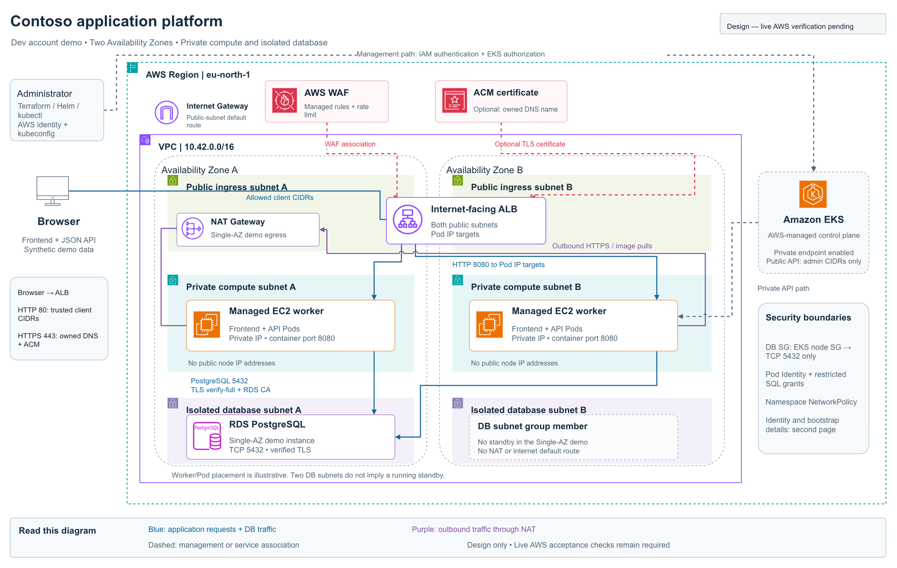
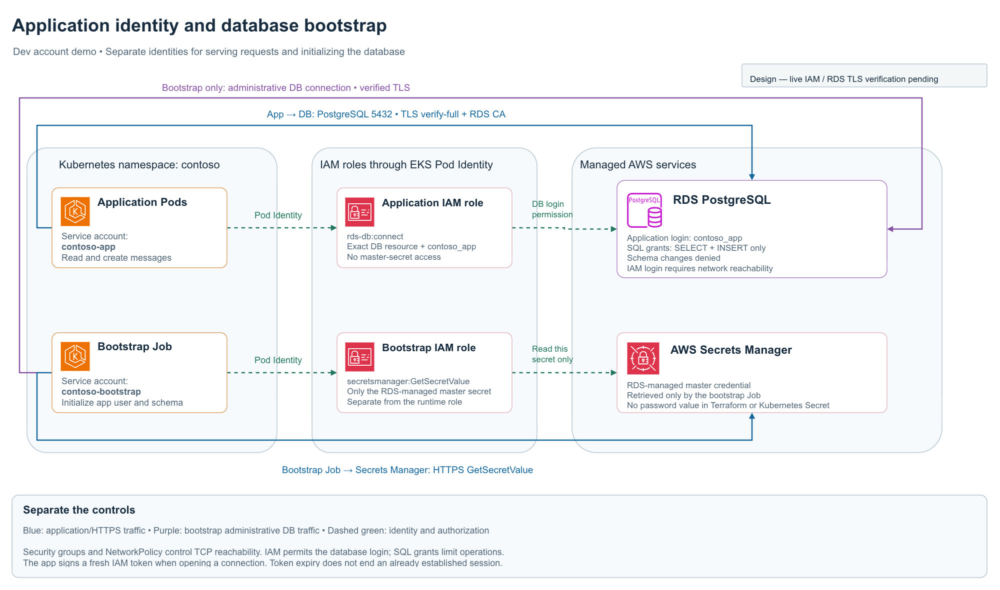

# Architecture

The diagrams show the **dev** environment. Test and prod are the same design in their own accounts, with one NAT gateway per AZ and Multi-AZ RDS.

[architecture.drawio](architecture.drawio) is the editable source, with two pages and native AWS icons. Open it in draw.io (web or Desktop). After editing, re-export the PNG/SVG files with `mise run diagrams:export` (draw.io Desktop) or with **File › Export as** in the web app: one page at a time, border 24, diagram included. [architecture.mmd](architecture.mmd) is a text-only overview.

## Request path

1. The browser calls the internet-facing **ALB** in the public subnets. WAF filters requests first.
2. The ALB forwards to **Pod IPs on TCP 8080**. The AWS Load Balancer Controller creates the ALB from the Kubernetes Ingress and keeps its targets in sync.
3. The app runs on **EKS managed nodes in private subnets**, without public IPs. One container serves the page and the JSON API.
4. The app connects to **RDS PostgreSQL on TCP 5432** with IAM authentication and TLS that verifies the server certificate and hostname (`verify-full`).

## Subnets

| Tier | Route to internet | Contains |
| --- | --- | --- |
| Public (2 AZs) | Internet Gateway | ALB, NAT gateway |
| Private compute (2 AZs) | Outbound only, via NAT | EKS nodes and Pods |
| Isolated database (2 AZs) | **None** | RDS |

## Allowed traffic

| From → To | Port | Enforced by |
| --- | --- | --- |
| Client → ALB | 80, or 443 with a certificate | ALB `inbound-cidrs` (your IP by default), WAF |
| ALB → app Pods | 8080 | ALB security group rules, NetworkPolicy |
| EKS nodes → RDS | **5432 only** | DB security group references the node security group, so there is no CIDR rule |
| App Pods → anything else | DNS 53, HTTPS 443, Pod Identity agent | NetworkPolicy (namespace default-deny) |
| Admin → EKS API | 443 | Public endpoint limited to `admin_cidrs`, plus IAM and Kubernetes RBAC |

Limit: the security group admits any Pod on those nodes to port 5432. The app's IAM role and its restricted SQL user are the per-workload boundary. Security groups for Pods would tighten this in production.

## Identity

- **EKS Pod Identity** gives each service account its own IAM role. IRSA is not used, because AWS-managed projects deny creating the IAM OIDC provider it needs.
- The **app** role can only `rds-db:connect` as `contoso_app`. It cannot read the master secret.
- A one-time **setup Job** has its own role. It reads the RDS-managed master secret and creates the schema and the restricted `contoso_app` user. No DB password passes through Terraform or Kubernetes.
- Nodes require IMDSv2 with hop limit 1, so Pods cannot fall back to the node role.
- The identity that runs `terraform apply` becomes EKS cluster admin through an access entry.

## Terraform roots

| Root | Owns | State |
| --- | --- | --- |
| `bootstrap/` | S3 state bucket | Local file, one per environment |
| `infra/` | VPC, EKS, RDS, ECR, WAF, IAM | `s3://contoso-<env>-tfstate-<account>/infra.tfstate` |
| `platform/` | Helm and Kubernetes resources | `.../platform.tfstate`; reads `infra` outputs via `terraform_remote_state` |

`platform` is separate because the Kubernetes and Helm providers need a cluster that already exists.
